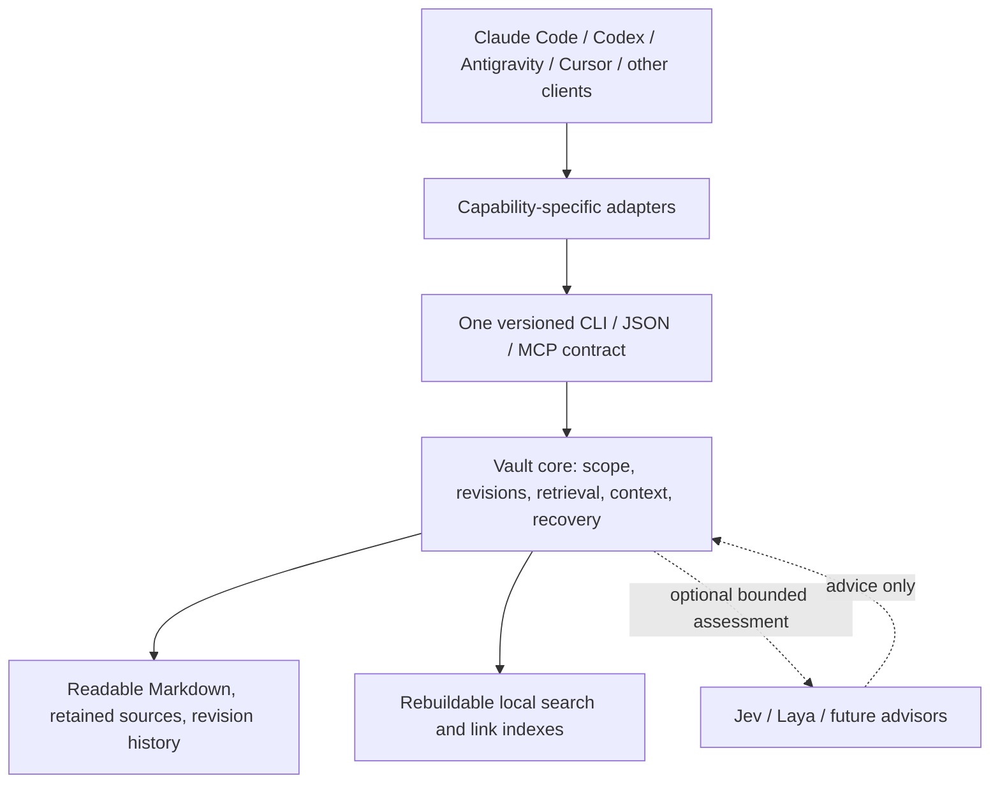

# Vault architecture

Proposal, 2026-10-10. Nothing in this document is an implemented guarantee.

## The organizing idea

The vault belongs to the person. Harnesses visit it; models help reason about it. Neither owns its schema or gets a separate copy of its knowledge.



The first release is a general vault even if implementation proceeds in small testable slices.

## Human organization

```text
My Vault/
  Home.md                  navigation and current areas of interest
  You/                     preferences, principles, goals
  Inbox/                   captured material awaiting organization
  Sources/                 original notes and retained source excerpts
  Knowledge/               concepts, people, lessons, linked explanations
  Projects/<project>/      overview, decisions, questions, current work
  Journal/                 dated observations and outcome links
  Sessions/<session-id>/   independent session cards and contributions
  Archive/                 visible historical material when useful
  Attachments/             selected source files; indexed only by policy
  .remember/
    vault.json             portable ID, schema and disclosure policy
    revisions/             immutable Markdown revision payloads
    operations/            immutable committed operation metadata
    proposals/             pending contributions and conflicts
```

This is a starter layout, not an indexing rule or a forced migration. Existing folder names and note bodies remain intact during adoption. A preview identifies candidate files, project mappings, exclusions, duplicate IDs and unsupported metadata before writing anything. The runtime never determines access from a folder's English name alone.

Machine paths, credentials, process locks, pending local transaction intents, logs, SQLite databases and embedding caches live in machine-local state outside the portable vault. A local binding maps a stable vault ID and project IDs to paths on that machine.

## Scope, lifetime, and disclosure are separate

| Dimension | Examples | Rule |
| --- | --- | --- |
| Scope | personal, explicitly shared, project:atlas, session:ID | A context request names permitted scopes. A project cannot inherit all personal notes implicitly. |
| Lifetime | durable, session, review-after date | A temporary observation does not automatically become a lifelong preference. |
| Disclosure | private, shared, public; remote assessment allowed/denied | Being locally relevant does not authorize transmission to an optional provider or public export. |

A project-specific exception can coexist with a general preference. Context must label both and their applicability rather than silently deleting one. Claims about code, personal preferences, and historical work use different freshness rules.

Personal sharing requires a trusted policy entry mapping a project ID to specific record IDs and destinations (for example, local agent context only). Default is deny. Note prose, folder membership, source links and advisor output cannot create a grant. A grant covers the current admitted revisions of its named ID; a successor with a new ID needs an authorized grant update, not automatic inheritance through a supersedes edge. Such an update can be included in an already authorized correction policy without adding a confirmation dialog to every write.

Grants live in portable vault policy, separately from note content, and policy changes have revision/conflict rules. A conflicting or malformed policy fails closed for affected disclosure. Revocation invalidates context/provider caches; each request rechecks the current policy revision. It cannot retract text already delivered to an external agent. The sample vault includes a non-executable policy sketch to make the intended grant explicit.

These controls govern the core's outputs and provider payloads. They do not sandbox a harness that already has direct filesystem access. Connecting a cloud-backed agent can transmit selected context to its normal model provider; local storage alone does not imply otherwise.

## Content model

Rich notes remain ordinary Markdown. The engine also understands small structured records where needed. Do not force a person's entire knowledge into one-fact-per-file forms.

| Object | What it carries |
| --- | --- |
| Source | Origin, capture time, retained or reference-only status, content revision, passage anchor. |
| Knowledge note | Human-readable explanation and typed links to other notes/sources. |
| Claim or decision | Statement, scope, evidence class, source references, lifecycle state, revision relationships. |
| Session card | Session ID, owning adapter/actor, project, objective, selected outcomes, open questions, next action. |
| Summary | Readable synthesis plus the exact dependency revisions from which it was made. |
| Operation | Globally unique operation ID, payload digest, base revision(s), actor, changed IDs, commit metadata. |

Evidence classes distinguish user statements, source excerpts, agent inferences, and observed command results. A high model score is not verification. Agent identity records provenance, not authority.

Managed properties use a namespaced, flat schema to avoid clashing with existing Obsidian properties. Illustrative fields:

```yaml
rd_schema: 1
rd_id: decision-atlas-email-002
rd_kind: decision
rd_scope: project:atlas
rd_state: active
rd_evidence: user-statement
rd_disclosure: private
rd_remote_allowed: false
rd_sources:
  - source-atlas-email#current-choice
rd_supersedes:
  - decision-atlas-email-001
aliases:
  - transactional email
  - email provider
```

Stable IDs survive renaming. A revision is a digest of defined canonical bytes, not a manually incremented frontmatter number. Reference metadata binds citations to source ID + revision + passage/quote digest; a path or URL alone is insufficient evidence of unchanged content. Bodies retain normal clickable links for humans.

Unmanaged notes can be adopted without rewriting frontmatter: the portable adoption map supplies IDs and declared scope. Renames are reconciled explicitly when identity is ambiguous. Equal content does not prove that two files are the same note. Duplicate IDs, malformed metadata, Unicode/case collisions, and paths outside the selected vault are surfaced rather than silently reassigned.

## A useful knowledge lifecycle

1. **Capture:** selected text or source references enter the inbox with provenance. Attachments require explicit inclusion; binaries are not silently executed or parsed with arbitrary external tools.
2. **Organize:** an active agent or human proposes concepts, aliases, links, and extracted claims. Exact links/backlinks are indexed locally; semantic relationships inferred by a model remain labeled proposals.
3. **Admit:** a user action or a standing, scoped capture policy can authorize a valid contribution. There is no mandatory confirmation dialog for every note. An advisor score cannot supply authorization.
4. **Use:** retrieve eligible passages with their scope, status, provenance and applicability. Return a real no-result state when needed.
5. **Correct:** a successor names its predecessor and expected revision; history remains navigable and searchable by former terminology.
6. **Maintain:** flag orphaned links, stale source references, unresolved branches, possible duplicate proposals, and aged session cards. Review recommendations do not delete durable knowledge automatically.

State and relations are explicit. `supersedes`, `retracts`, `supports`, `opposes`, and `derived-from` mean different things. Time alone does not select the true claim. A summary becomes review-needed when a dependency changes; a file hash change does not prove the summary false.

No single mutable Last-Session note is shared by all agents. Session cards are independent. A project overview can link to several cards and is updated through expected-revision rules.

## Authority and storage

Markdown owns the content. Portable committed revision payloads and operation metadata own admitted history and head relationships. SQLite owns only rebuildable projections; it cannot silently override those sources.

Visible notes are editable authoring surfaces. Committed revision snapshots preserve the exact content used by a past operation. This is version history, not a second independently editable memory database.

For each materialized note, portable metadata distinguishes the admitted head revision(s) from the last materialized revision/digest. Local observations track the current file digest. If the visible file still equals its last materialized digest while an admitted head has advanced, the file is **surface-behind**, not a new external edit. Retrieval uses the admitted head and reports that the visible file awaits refresh, with a link to the retained revision and a patch preview. If the file differs from its last materialized digest, reconcile it as an external candidate based on that materialized revision, preserving any newer admitted head as a competing input. An applied patch is acknowledged only after readback confirms its exact digest; a mismatched readback remains unresolved. No silent reset of the visible file is permitted.

Before retrieval, synchronize observed edits for relevant included sources. A changed authoring surface is a new observed revision, not an excuse to rewrite the old committed snapshot. Show it as pending/review-needed until reconciled under the capture policy. Do not silently serve an old admitted revision as the current version of an externally changed note. Ordinary source search may expose the newly observed text with its provisional status; current-decision context must disclose uncertainty or omit it with a reason.

For managed operations:

1. Validate the vault, schema, source eligibility, expected base revisions and scoped write authority.
2. Acquire the participating-writer lock and reconcile pending recovery. Under the lock, re-read current heads, source observations and policy, then revalidate expected bases and scoped write authority. A pre-lock check alone cannot authorize publication.
3. Persist an intent and immutable revision payloads; record their digests. Hold the participating-writer lock throughout publication.
4. Immediately before publication, recheck the observed bases/head set and authority under the lock. Publish an immutable commit manifest referencing the complete payload set. This is the commit point for core readers. External-editor races still follow the separate proposal/reconciliation contract below.
5. Update derived indexes, then acknowledge the operation. Retry with the same operation ID returns the original outcome; a changed payload under that ID is an error.

Recovery completes projection updates for valid commits and exposes incomplete or corrupt commits. Reindexing must reproduce heads, corrections and conflicts from portable sources alone. Durable publication mechanics, flush behavior, locks and crash recovery must be proven on each supported operating system before release.

### External-editor limit

An app lock does not lock Obsidian or an arbitrary text editor. Atomic replacement alone cannot prevent a human edit from being overwritten in a race.

The safe default is therefore: **agent changes to an existing externally editable note are separate Markdown revision proposals, not automatic in-place rewrites.** Agents may directly create new authorized notes and correction records under unique IDs. Reconciliation preserves the observed human revision and agent proposal as competing inputs. Automatic materialization requires an explicitly cooperative editing path; otherwise provide an inspectable patch/export for application by the owner.

Do not promise to preserve every keystroke made between scans. Unobserved editor changes need that editor's history or a filesystem backup. Preserve all payloads actually submitted to the engine.

## Retrieval and context quality

1. Resolve vault, project, explicitly shared personal scope, disclosure policy, source status, and unresolved branches.
2. Retrieve heading-aware passages with local lexical search, aliases and bounded explicit-link expansion. Gate before expansion and again before output; unauthorized neighbor titles must not leak.
3. Optionally add semantic candidates through a separate embedding interface. Record model/index version and locality. The lexical baseline remains available.
4. Optionally assess eligible candidates through an advisor. It can select only IDs actually in the bounded candidate set.
5. Resolve correction chains and include required conflict/applicability context as indivisible bundles.
6. Pack whole passages and mandatory metadata inside the portable budget, then recheck source revisions and current disclosure before delivery.

The packet contains a schema version, vault ID, observed snapshot, selected IDs/revisions, passages, source citations, evidence class, scope, warnings, selection reasons, omitted counts and reasons, and provider/fallback status. It does not dump the full vault.

Use a defined UTF-8 byte budget in the portable protocol. Headers, escaping, source labels, warnings and omission notices count. Token estimates are labeled estimates unless a specific tokenizer and version are declared. If a minimum required uncertainty bundle cannot fit, return an explicit budget-too-small result instead of implying a settled conclusion.

`explain` should answer: “Why did you include this?”, “Why did you omit that?”, and “Which source version did this come from?” Explanations obey the same scope rules as retrieval.

Test English and Turkish fixtures because the owner works in both. Lexical recall is not universal paraphrase understanding; source/query cases that require semantic matching must be evaluated separately. No accuracy percentage is specified before a reproducible baseline exists.

## Synchronization, deletion, and recovery

The format supports unique operation IDs, multiple heads and tombstones from the beginning. A later optional sync transport moves portable files; it does not decide which conflicting decision wins.

- Never sync local SQLite, locks, machine paths, credentials or caches.
- Offline competing successors remain multiple heads. Resolution names every observed head and refuses a stale/incomplete set.
- A synced deletion is a tombstone, so an older device cannot silently resurrect the note. Purging content/history is a separate deliberate operation with disclosed backup implications.
- Import copies and conflicted Markdown files are reconciled through IDs and parents, not file timestamps or union merge.
- Backup includes content, retained attachments, committed revisions, policy and operation metadata. Restore validates references and builds fresh local indexes.
- Migrations provide a dry run and recoverable backup, preserve external edits, and refuse unsafe downgrades.

## Inspection surfaces

Planned operations: `doctor`, `explain`, `history`, `conflicts`, `reconcile`, `reindex`, and backup/restore. Exact command syntax is not implemented. Reports identify malformed files, ignored imports, stale references, incomplete commits and provider failures without claiming to repair everything automatically.

## Five hard acceptance gates

1. Four-harness correction with a personal default, a project exception, and an unrelated sensitive source: each receives only its permitted, appropriately scoped current context.
2. Two agents plus a human editor: preserve submitted changes, handle renames/malformed metadata, and expose competing revisions without claiming an unsafe overwrite succeeded.
3. Kill the process at every durable-write boundary, retry operation IDs, and rebuild SQLite: content, head sets, supersession, and recovery results remain consistent.
4. Offline forks plus source deletion, delivered in either order: same unresolved heads, no silent resurrection, and rejection of resolution based on incomplete heads.
5. A mixed corpus of opposing claims, stale summaries, moved sources, prompt-like source text and oversized records: budget and scope hold, and uncertainty survives packaging.
